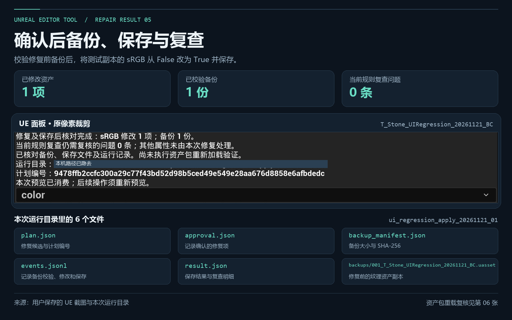

# UE 纹理资产规范检查与批量修复工具

[工具界面](docs/images/01_overview.png) · [用途对比](docs/images/02_purpose_comparison.png) · [批量导出](docs/images/03_batch_report.png) · [修复预览](docs/images/04_preview.png) · [重载复核](docs/images/06_reload_check.png)

这是一个基于 Unreal Engine **Editor Utility Widget + Python** 的技术美术工具。在内容浏览器选中纹理后，声明本批用途，工具按项目规则读取属性、导出问题清单，并对审核过的 sRGB 候选先备份、再修改和保存。

| 能力 | 行为 |
| --- | --- |
| 规范检查 | 命名前后缀、源尺寸预算与二次幂、用途对应的 sRGB 和压缩设置 |
| 用途声明 | `color`、`normal`、`mask` 或 `unknown`。不同用途分批检查 |
| 报告导出 | `audit_report.json`、`issues.csv`、`suggestions.csv` |
| 修复预览与执行 | 只应用明确确认的 **sRGB** 候选。预检选择和资产状态，核验备份后逐个保存，再复查并写入运行记录 |

修复范围是示例目录 `/Game/TextureAuditDemo/` 内已保存的单文件 `Texture2D`。原始样例 `T_Stone_BC` 受到保护。命名、压缩、尺寸问题由人工复核。

## 在 UE 中复现

1. 从 GitHub 下载或克隆整个仓库，在 **Windows + Epic Games Launcher 版 Unreal Engine 5.3.2** 下打开 `TextureAuditTool.uproject`。若系统提示选版本，选择本机 UE 5.3。工程已启用 **Python Editor Script Plugin** 和 **Editor Scripting Utilities**，脚本使用 Python 标准库。
2. 在内容浏览器打开 `Content/EditorTools`，右键 `EUW_TextureAuditTool` → **Run Editor Utility Widget**。背景关卡使用 UE 自带模板。工具读取内容浏览器当前所选的纹理。
3. **对照检查**。只选 `Content/TextureAuditDemo/T_Stone_BC`。用途选 `color`，点「扫描所选纹理」，预期当前规则问题 0 条。改为 `normal` 后重新扫描，预期问题 3 条、待确认建议 2 项、资产修改 0 项。
4. **批量报告**。选中 `T_Stone_UIBatchA_BC` 和 `T_Stone_UIBatchB_BC`，用途选 `normal`。在报告目录框输入一个新名字，如 `example-report`，点「导出检查报告」。预期两张纹理、问题 6 条、建议 4 项。三份报告位于 `Saved/TextureAudit/Reports/example-report/`。
5. **修复示例**。只选 `T_Stone_BadSRGB_BC`，用途选 `color`，点「预览修复方案」。初始预期有一项 `sRGB False → True`。在修复目录框输入新名字 `example-repair`，核对候选后点「确认并执行修复」。可先在原生对话框选「否」，观察取消后需要重新预览。确认执行后，查阅 `Saved/TextureAudit/RepairRuns/example-repair/` 下的方案、确认记录、备份、日志和结果。完成后可重新扫描，或重新打开工程验证保存值。

目录框接受新的单级运行名，可用字母、数字、连字符和下划线。已有目录会被拒绝，重复演示时请换名字。修复会实际保存示例资产，建议在独立的下载副本中练习。

## 我的实现与验证

我设计了检查与修复的操作流程，在 UE 里搭建控件、连接按钮和用途输入，准备了对照纹理，并在编辑器中验证报告、取消确认、拒绝复用目录、保存及资产包重载。Python 的规则、桥接代码和验证脚本有 AI 辅助。石材样例由我用 ComfyUI 生成，再导入 UE 并制作属性对照副本。

- 原版实测环境为 **Unreal Engine 5.3.2**。两张样例统一声明为 `normal` 时，真实导出记录为 **6 条问题、4 项建议、0 项资产修改**。见[两图报告](docs/evidence/audit-batch-normal/audit_report.json)。
- 一次原版确认修复修改 **1** 张测试副本，创建并核验 **1** 份备份，当前规则复查问题为 **0**。后续单独重载该资产包，sRGB 仍为 `True`。见[修复记录](docs/evidence/repair-example/result.json)和[重载证据](docs/images/06_reload_check.png)。
- 公开副本把路径改为随工程解析。报告、原版实测范围和公开副本的检查结果见[验证记录](docs/evidence/validation.md)。

## 复用源码

规则在 [rules.py](Content/Python/texture_audit/rules.py) 的 `AuditPolicy` 中，修改这里可以适配项目自己的命名后缀、尺寸预算及用途规则。UE 属性读取、报告生成和受控修复分别位于 `Content/Python/texture_audit/`。蓝图从工程的 `Content/Python/` 加载四个按钮对应的入口，运行工具无须 ComfyUI 或外部 Python 服务。

没有 UE 时，可以离线检查规则和报告格式，需要 Python 3.9 或更新版本。以下命令用合成记录生成样例报告，结果位于 `Saved/TextureAudit/Offline/`：

~~~powershell
py -3 -B Content/Python/demo_offline.py
py -3 -B tools/verify_portable_paths.py
~~~

`SourceArt/` 含示例贴图源图。项目原创软件代码和编辑器蓝图的复用许可见 [LICENSE](LICENSE)，示例纹理及演示材料的出处见[素材说明](docs/ASSETS.md)。
